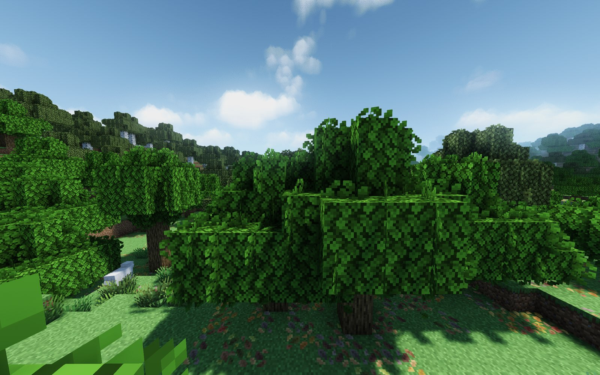
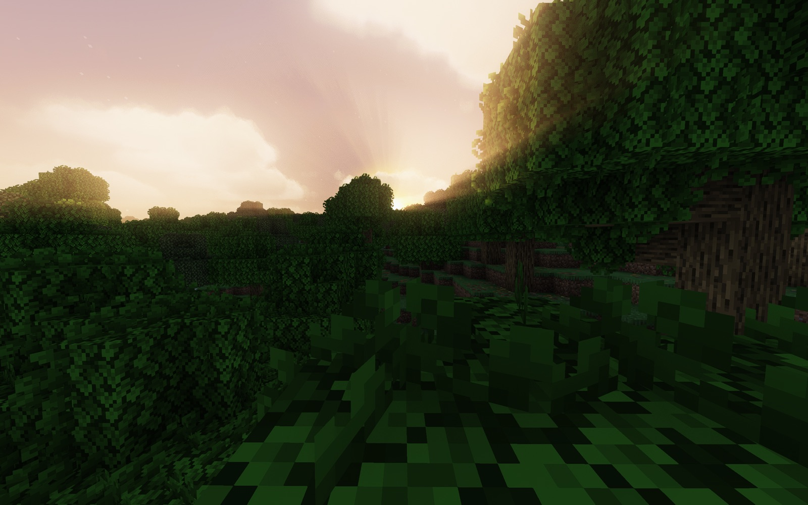
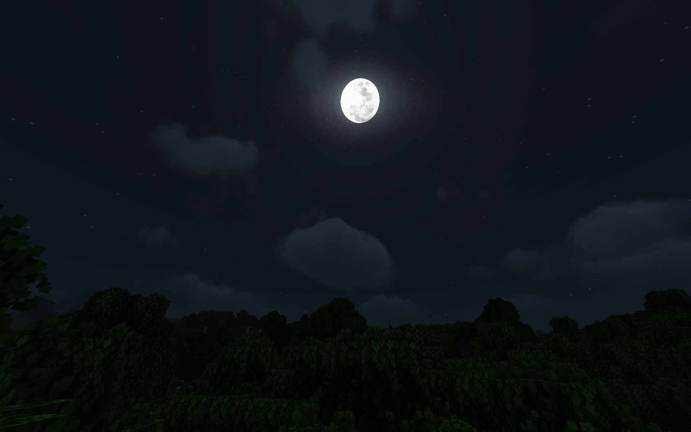
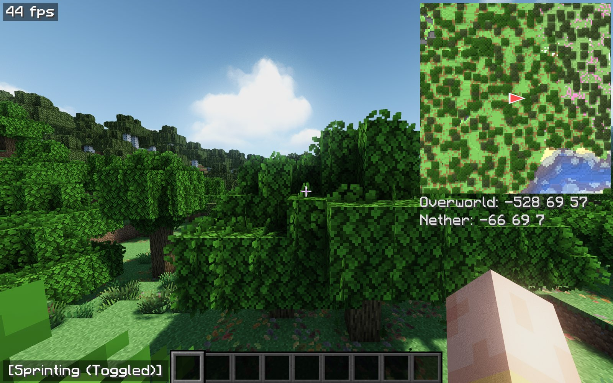
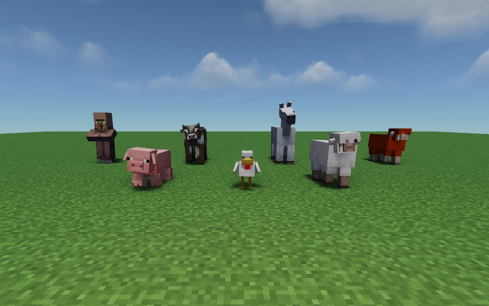

  

# Horizon M1: Minecraft for Apple Silicon Macs

Horizon M1 plays Minecraft: Java Edition 26.3 on Apple Silicon Macs. [Horizon](https://github.com/horizon-rust/horizon) ([site](https://playhorizon.dev)) is an unofficial rewrite of the game in Rust, so it runs natively and smoother on an 8 GB M1. This build includes 16 mods and the author's full look (64 resource packs and the MakeUp shader). It has a one-click installer, and you do not need Java.

You need your own Minecraft: Java Edition.

## Install with one line

Open Terminal (press Cmd+Space, type `Terminal`, press Return), paste this line and press Return:

```bash
zsh -c "$(curl -fsSL https://raw.githubusercontent.com/tm-droid/horizon-m1/main/install.sh)"
```

It downloads the latest build (about 210 MB), checks it, and starts the installer. No macOS security warnings, no unzipping. Run the same line again later to update.

Prefer clicking? [Download Horizon-M1-daily7.zip](https://github.com/tm-droid/horizon-m1/releases/latest/download/Horizon-M1-daily7.zip) and follow [Quick start](#quick-start).

| | |
|---|---|
|  |  |
|  |  |
|  | |

*Taken on an 8 GB M1 MacBook Air with the full look (64 resource packs and the MakeUp shader).*

> Horizon M1 is not affiliated with, endorsed by, or connected to Mojang or Microsoft. It contains no Minecraft game files.

## Contents

- [Install with one line](#install-with-one-line)
- [Requirements](#requirements)
- [Quick start](#quick-start)
- [Playing next time](#playing-next-time)
- [Install details](#install-details)
- [Controls](#controls)
- [Tips for smooth FPS on 8 GB](#tips-for-smooth-fps-on-8-gb)
- [FAQ](#faq)
- [Troubleshooting](#troubleshooting)
- [Uninstall](#uninstall)
- [What's included](#whats-included)
- [Advanced](#advanced)
- [Credits and licenses](#credits-and-licenses)
- [For developers](#for-developers)

## Requirements

- A Mac with Apple Silicon (M1, M2, M3 or M4). Intel Macs and Windows are not supported by this build.
- macOS 12 or newer.
- About 2 GB of free disk space.
- Minecraft: Java Edition (for a Microsoft account, or for the offline option below).

## Quick start

The [one-line install](#install-with-one-line) skips steps 1 to 4 below and goes straight to step 5. To install from the zip instead:

1. **Download** the zip with the link at the top of this page.
2. **Open the zip.** Open Finder and click **Downloads** in the sidebar. Double-click `Horizon-M1-daily7.zip`. You get a folder called `Horizon M1`. (Safari may have unzipped it for you. Then the folder is already there.)
3. **Open the installer.** Inside the folder, Control-click `Install Horizon M1.command` (or click it with two fingers). Choose **Open**, then click **Open** again in the warning. A normal double-click does not work the first time.
4. **If macOS blocks it** (macOS 15 or newer): click **Done**. Click the Apple menu, then **System Settings**, then **Privacy & Security**. Scroll to the bottom. Click **Open Anyway** next to the installer's name. Type your Mac password if it asks. Then open the installer again (step 3).
5. **Answer two questions.** A Terminal window opens. This is a text window, and it is normal. It asks two questions. Type the number and press Return (the Enter key).
   - "Install the full look?" Type `1`, `2` or `3`. Just pressing Return gives you `1`, the full look.
   - "How will you play?" Type `1` for a Microsoft account, or `2` for offline.

   When it says **Done**:
   - **Microsoft account:** the Horizon launcher opens. Sign in, then press **Play**. The first start prepares files and takes a few minutes.
   - **Offline:** it asks for a player name, then makes an app called "Horizon Offline". At "Start it now? (y/n)" type `y` to play.

Offline needs Minecraft Java 26.3 on this Mac: either already installed in a Minecraft launcher, or downloaded by the installer after one Microsoft sign-in. See [Offline](#b-offline-no-sign-in) below.

To skip the questions, put the answers in front of the one-line install. `HM1_LOOK` is the look (1, 2 or 3), `HM1_MODE` is how you play (1 or 2), and `HM1_NAME` is the offline player name:

```bash
HM1_LOOK=1 HM1_MODE=1 zsh -c "$(curl -fsSL https://raw.githubusercontent.com/tm-droid/horizon-m1/main/install.sh)"
```

## Playing next time

You do not need to run the installer again.

- **Microsoft account:** open **Horizon** from Launchpad or the Applications folder, then press **Play**.
- **Offline:** open **Horizon Offline** from Launchpad. It shows no window of its own. The game window appears after a few seconds. If nothing appears, see [Troubleshooting](#troubleshooting).

## Install details

Quit Horizon first if it is open. The installer refuses to run while the Horizon game or launcher is open ("Quit it (Cmd+Q) first").

The installer copies `Horizon.app` (the official launcher) to `/Applications`, installs the tuned build, selects it, and turns off the launcher's auto-install of new versions so the M1 build stays selected. It also adds starter graphics settings if you have none.

The folder `Horizon M1` holds `Install Horizon M1.command`, `Uninstall Horizon M1.command`, `READ ME FIRST.txt` and a `LICENSES` folder.

First it asks which look you want:

```
Install the full look (64 resource packs + MakeUp shader)?
  1) Full look   all packs + shader (recommended, about 45 fps on an M1 Air)
  2) Fast look   same without Optimized Bushy Leaves (about 58 fps)
  3) Plain       no packs, no shader (fastest)
Type 1, 2 or 3 and press Return [1]:
```

Pressing Return alone picks 1. More about the choices is in [The look](#the-look-resource-packs-and-shader).

Then it asks how you will play:

```
How will you play?
  1) Microsoft account  (normal: multiplayer servers, your skin)
  2) Offline            (no sign-in: singleplayer, LAN and offline-mode servers)
Type 1 or 2 and press Return:
```

### A. Microsoft account

Pick this if you own Minecraft: Java Edition. You get multiplayer servers and your skin.

1. Type `1` in the installer. It prints Done and the Horizon launcher opens.
2. Sign in with the Microsoft account that owns Minecraft: Java Edition.
3. Press **Play**. The first start prepares the game files and takes a few minutes. Later starts are fast.

### B. Offline (no sign-in)

Pick this if you want to play without signing in. Offline mode works for singleplayer, LAN, and servers that run in offline mode. Most public servers (like Hypixel) will not let offline players in. Offline mode has no Microsoft skin.

Horizon builds its textures and sounds from Minecraft: Java Edition 26.3. The installer gets it one of two ways:

- **Already installed:** if 26.3 was launched once in any Minecraft launcher on this Mac (official launcher, Prism, Modrinth App, MultiMC, ATLauncher, GDLauncher and others), the installer finds it by itself.
- **Not installed:** type `d` when the installer asks. You sign in once in your browser with the Microsoft account that owns Minecraft, and the installer downloads 26.3 from Mojang. You don't need the Minecraft Launcher, and you can still play offline afterwards.

1. Type `2` in the installer.
2. At "Pick a player name (3-16 letters, numbers or _):" type a name of 3 to 16 letters, numbers or `_`.
3. The installer prepares the game from Minecraft 26.3 and prints the folder it used. If it finds none, type `d` to download it (see above). You can also drag a game folder (the one holding `versions` and `assets`) into the Terminal window and press Return.
4. It creates the "Horizon Offline" app. It shows up in Launchpad. The file is in your home folder's Applications folder: in Finder choose **Go > Home**, then open **Applications**. (The path is `~/Applications/Horizon Offline.app`.)
5. It asks "Start it now? (y/n)". Type `y` to play.

### Still blocked by macOS?

This only happens with the zip. The easiest fix is the [one-line install](#install-with-one-line). Or open Terminal (press Cmd+Space, type `Terminal`, press Return), paste this line and press Return, then double-click the installer again:

```sh
xattr -dr com.apple.quarantine ~/Downloads/"Horizon M1"
```

If you moved the `Horizon M1` folder out of Downloads, change the path to where it is now.

## Controls

Basic controls (the usual Minecraft ones):

| Action | Key |
|---|---|
| Look around | Mouse |
| Move | W A S D |
| Jump | Space |
| Sneak | Left Shift |
| Sprint | Left Ctrl |
| Break block / attack | Left click |
| Place block / use item | Right click |
| Select hotbar slot | 1 to 9 or scroll wheel |
| Inventory | E |
| Drop item | Q |
| Hide HUD | F1 |
| Screenshot | F2 |
| Debug screen | F3 |
| Pause menu | Esc |
| Light level overlay | F7 |

Keys added by mods (zoom, minimap and so on) can be changed in **Options > Controls**.

## Tips for smooth FPS on 8 GB

FPS means frames per second. Higher is smoother.

- Close Chrome and other heavy apps. When macOS starts swapping memory to disk, FPS collapses.
- Set render distance to 10 to 12.
- In Video Settings, set resolution scale to 70 to 85. A lower resolution scale draws fewer pixels, so you get more FPS.
- Plug in the charger.
- The shader roughly halves FPS. Turn it off in Shader Packs if the game stutters.
- Optimized Bushy Leaves costs about 12 FPS and 320 MB of memory. Choose the Fast look, or turn it off in Resource Packs.

## FAQ

**Do I need to buy Minecraft?**
For the Microsoft option, yes: you sign in with an account that owns Minecraft: Java Edition. The offline option plays without signing in, but it still needs Minecraft: Java Edition 26.3 on the Mac, because Horizon builds its textures and sounds from it. Either launch 26.3 once in any launcher, or let the installer download it after one sign-in. Horizon M1 contains no Minecraft game files.

**Is this safe? Why does macOS show a warning?**
The installer and app are not signed by Apple (that costs a yearly developer fee). They are downloaded from GitHub. macOS warns about anything that does not come from the App Store or a paid Apple developer account, so the warning is expected. To open it anyway, Control-click the installer, choose **Open**, then **Open** again. If that fails, use **Open Anyway** in **System Settings > Privacy & Security**, or the `xattr` command in [Install details](#install-details). The source patches are in this repo, and the release page lists the zip's SHA-256 checksum so you can check your download (see [Check your download](#check-your-download)).

**Can I play with friends?**
With a Microsoft account, yes: join online servers that support Minecraft 26.3. Offline mode only works on LAN and on servers set to offline mode. Most public servers, like Hypixel, will not let offline players in.

**Will it delete my Java Minecraft worlds?**
No. Horizon keeps its own data in a separate folder (`~/Library/Application Support/horizon`) and only reads from your Minecraft install. Your old worlds are not touched.

**How do I turn the shader or packs off?**
In the game, go to **Options > Video Settings > Shader Packs** and pick no shader, and to **Options > Resource Packs** to move packs off the active list. Turning off the shader helps most if the game stutters.

**Can I use Java mods or my own packs?**
Resource packs: yes, any. Java mods: only their content (blocks, items, biomes), and only some of them. Rust mods made for Horizon: yes, with a compile step. See [Add your own mods and packs](#add-your-own-mods-and-packs).

**Does it work on Intel Macs or Windows?**
No. This build is for Apple Silicon Macs (M1, M2, M3 or M4) only.

## Troubleshooting

**Something went wrong or looks weird?**
Message whoever sent you Horizon, or [open an issue](https://github.com/tm-droid/horizon-m1/issues/new) with what happened. A log link from `share-log` (below, under "The game crashes") helps a lot.

**macOS says the installer is "damaged" or "can't be opened".**
Follow the steps in [Quick start](#quick-start), steps 3 and 4: Control-click > Open, **Open Anyway** in System Settings, or the `xattr` command in [Install details](#install-details).

**The installer says the Horizon game or launcher is open.**
Quit it with Cmd+Q, then run the installer again.

**The installer says it "could not find Minecraft 26.3".**
Type `d` to sign in once and download it from Mojang. Or launch 26.3 once in your Minecraft launcher and press Return to try again. See [B. Offline](#b-offline-no-sign-in).

**The game crashes or won't start.**
Print the logs with:
```sh
/Applications/Horizon.app/Contents/MacOS/horizon-launcher logs
```
To get a link you can send to someone for help, run:
```sh
/Applications/Horizon.app/Contents/MacOS/horizon-launcher share-log
```

**Horizon Offline does nothing when I open it.**
It shows no window of its own, and the game window can take a few seconds. If nothing appears, check `~/Library/Application Support/horizon/logs/play-offline.out`.

**Low FPS.**
See the [tips above](#tips-for-smooth-fps-on-8-gb).

## Uninstall

Paste this line into Terminal and press Return:

```bash
zsh -c "$(curl -fsSL https://raw.githubusercontent.com/tm-droid/horizon-m1/main/dist/uninstall.command)"
```

Or double-click `Uninstall Horizon M1.command` in the `Horizon M1` folder from the zip (open it the same way as the installer). It moves Horizon to the Trash. It asks before it touches your worlds. Type `DELETE` if you also want your worlds moved to the Trash.

To do it by hand, delete these:

- `/Applications/Horizon.app`
- `~/Applications/Horizon Offline.app`
- `~/Library/Application Support/horizon-launcher`
- `~/Library/Application Support/horizon`

Warning: the `horizon` folder holds your worlds. Back it up first if you want to keep them.

## What's included

### Mods

| Mod | What it does | Author |
|---|---|---|
| AppleSkin | Shows food and saturation on the HUD | [soufied/AppleSkin-Horizon](https://github.com/soufied/AppleSkin-Horizon) |
| Zoom, Minimap, FPS overlay | Zoom key, a small map, an FPS counter | [horizon-rust/horizon-mods](https://github.com/horizon-rust/horizon-mods) |
| Minimap Worldmap & Waypoints Reworked | Full world map and waypoints | [daniliammo](https://github.com/daniliammo) |
| Fullbright, Armor status, Status effect HUD, Toggle sprint, Light overlay (F7), Crosshair indicator | Quality-of-life HUD and view tweaks | [CayMac97](https://github.com/CayMac97) |
| Chat heads | Shows player heads next to chat messages | [Domanffe](https://github.com/Domanffe) |
| Held item info | Shows details of the item in your hand | [AltMugen](https://github.com/AltMugen) |
| Jade | Look-at tooltip for blocks and mobs | [Joeypc6](https://github.com/Joeypc6) |
| Dynamic FPS | Drops to 20 fps when the window is idle for 60 s, saving battery | [Lyvt-Dev](https://github.com/Lyvt-Dev) |
| Dynamic lights | Held light sources light up their surroundings | [DeportedToHell/MCRE-Mods](https://github.com/DeportedToHell/MCRE-Mods) |

Full credits and licenses: `LICENSES/CREDITS.md` inside the zip, or [dist/LICENSES/CREDITS.md](dist/LICENSES/CREDITS.md) in this repo.

### The look: resource packs and shader

The installer puts in the full look from the author's own game. Press Return for it, or pick a lighter one:

| Choice | What you get | FPS on an M1 Air (85% resolution) |
|---|---|---|
| 1. Full look | All 64 packs + MakeUp Ultra Fast shader | about 45 |
| 2. Fast look | Same, without Optimized Bushy Leaves | about 58 |
| 3. Plain | Vanilla textures, no shader | highest |

What the packs do:

- **Mobs and animation:** Fresh Animations with all extensions, Just Expressions, player animations, Minecarts with Wheels, Fresh Skeleton Physics.
- **3D blocks and plants:** connected bricks and rocks, bushy leaves, colorful leaves and grass, flowers, crops, fungi, vines, carpets, bookshelves, doors, ladders, rails, torches, beds, lanterns.
- **Items:** Fresh food, buckets, ores, music discs, animated items, armor and trims, totems, glowing ores, a lower shield and fire overlay.
- **Sky, sound and UI:** Dramatic Skys (slimmed for 8 GB), gentler weather sounds, villager voices, colored subtitles, item icons, darker containers, an improved font.
- **Horizon compatibility packs** (`Horizon-*-Compatibility`, `Tanush Fixes`, `Horizon-Texture-Fixes`): fixes made for Horizon so the packs above render correctly (mob parts, dyed sheep, swords, buckets). The source of `Horizon-Texture-Fixes` is in `dist/fixpack`.

To switch the look in the game, go to **Options > Resource Packs** and **Options > Video Settings > Shader Packs**. The installer never overwrites pack files you already have, and packs you had enabled stay enabled. Pack authors and descriptions: `LICENSES/PACKS.md` in the zip.

### Why only 16 mods?

The original Java setup had 259 mod JARs. Horizon is written in Rust, so Java mods can't run in it. Mods have to be rewritten for Horizon, and the 16 in the table above are the ones that exist so far. Most of the old look came from resource packs and a shader, and those work in Horizon. The converter in `tools/horizon-convert.py` turned the rest into the compatibility packs. It needs a Java Minecraft instance to read from, so it is a developer tool: you get its output in the zip and don't need to run it.

## Advanced

### Add your own mods and packs

Everything below uses Terminal (in Applications > Utilities). First paste this line and press Return, so the
commands after it are short:

```sh
HL=/Applications/Horizon.app/Contents/MacOS/horizon-launcher
```

**Resource packs and shaders: easy and safe.**
Normal Minecraft Java resource packs work. Either drag the pack's `.zip` into
`~/Library/Application Support/horizon/resourcepacks` (in Finder: **Go > Go to Folder**, paste the path), or
search and install it from Modrinth:

```sh
$HL mods search "fresh animations"
$HL mods install <name-in-brackets-from-the-search>
```

Then turn it on in the game: **Options > Resource Packs**. Shader packs go in the `shaderpacks` folder and are
picked in **Options > Video Settings > Shader Packs**.

**Java mods: some of them, partly.**
Horizon can't run Java code, but the launcher can carry over a Java mod's *content*: its blocks, items,
recipes, loot, world generation and textures. Machines, new mobs, menus and anything that changes how the game
works don't come along. Ask the launcher first, then install, then restart the game:

```sh
$HL mods search --kind mod "biomes"
$HL mods check biomes-o-plenty
$HL mods install biomes-o-plenty
```

Tested with this build: **Biomes O' Plenty** says "Partly" (439 blocks, 33 items, its biomes) and loads fine
in the M1 build. **Sodium** says "Doesn't run" (it is all code). Performance mods like Sodium, Lithium or
OptiFine are never needed: Horizon is already native. Remove a mod with `$HL mods remove <name>`, or switch
it off with `$HL mods disable <name>`. Installing Java-mod content never replaces the M1 build.

**Java modpacks:** `$HL modpack import <file.mrpack>`, then `$HL modpack port <name>` and
`$HL modpack play <name>`. A modpack becomes its own profile with only the parts Horizon can carry over.

**Rust (native) mods: advanced.**
Mods written for Horizon can be installed from GitHub with `$HL mods add-github <github link>`. The launcher
then downloads its own Rust compiler and compiles the mod on your Mac (several GB of disk and some minutes).
The mod's code runs with full access to your Mac, so only install mods from people you trust. This path is
not tested with the M1 build. If the game changes or breaks afterwards, run `Install Horizon M1.command`
again: it selects the M1 build again and keeps your worlds.

### Updating

- The launcher may offer newer Horizon releases. The installer turned off auto-install so the M1 build stays selected. Only install a newer release if you want to leave the M1 build.
- To go back after trying another version, pick the M1 build in the launcher under Settings > selected version, or run:
  ```sh
  /Applications/Horizon.app/Contents/MacOS/horizon-launcher settings selected-version native-fdc87ae-m1-daily7-fix3-960d547ba1bd
  ```
- For a new M1 build, run the [one-line install](#install-with-one-line) again (or download the new zip and run its installer). Worlds, packs, shaders, settings, mod settings and your own mods carry over. The built-in mods come with every M1 build. The game files prepared from Minecraft 26.3 carry over too when the new build prepares them the same way; if not, the installer asks for 26.3 once more.

### Where things live

| What | Location |
|---|---|
| Worlds and game settings | `~/Library/Application Support/horizon` |
| Launcher and installed builds | `~/Library/Application Support/horizon-launcher` |

### Check your download

The one-line install checks the download by itself. For the zip: the release page <https://github.com/tm-droid/horizon-m1/releases/latest> lists the SHA-256 checksum of the zip. To check your download, run `shasum -a 256 ~/Downloads/Horizon-M1-daily7.zip` in Terminal and compare the result with the release page.

## Credits and licenses

- Horizon is made by [horizon-rust](https://github.com/horizon-rust/horizon) and is licensed under LGPL-3.0.
- Each mod belongs to its author (see the mods table).
- The modified source in this build is the set of patches in this repo (see below).
- Minecraft is a trademark of Mojang Studios / Microsoft. No Minecraft files are included.

## For developers

Tuning and mod work for Horizon (native Rust/Metal Minecraft 26.3 client) on a MacBook Air M1, 8 GB.

- `outputs/horizon-native/<fix>/` patches against Horizon commit `fdc87ae`, each with `NOTES.md`. Build stacks: `outputs/horizon-native/daily*-stack.txt` (current: `daily7-stack.txt`).
- `outputs/horizon-runtime/build-fast-fdc87ae.py` builds a client from a stack plus the mods in `mods.lock.tsv` (repo + pinned commit per mod).
- `outputs/bench-2026-11-10/` bench harness (`bench.py`), gallery test (`gallery.py`), run results (`runs/*.json`).
- `tools/`, `tests/`: converter and test tools. `docs/`: research and reports.
- `config/`: snapshot of the live game and launcher settings. `tools/config-sync.sh snapshot` copies live settings in (then commit); `tools/config-sync.sh restore` puts them back (game and launcher closed). Account files are not tracked.
- `dist/` holds the release installer. `dist/package.sh` builds the zip from the live build.

Builds, source clones, screenshots and pack zips stay local (see `.gitignore`).

License: the patches and scripts here are LGPL-3.0 like upstream Horizon (see [LICENSE](LICENSE) and `dist/LICENSES/`). Mods listed in `mods.lock.tsv` belong to their authors and are not included here.
